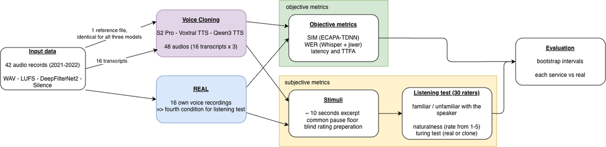
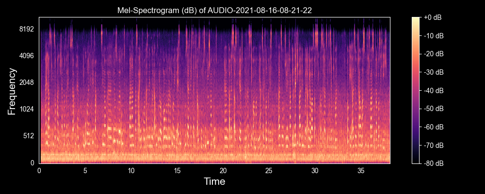
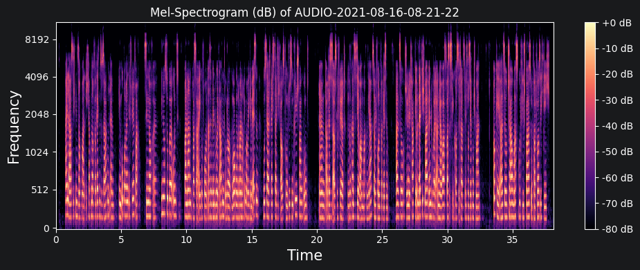
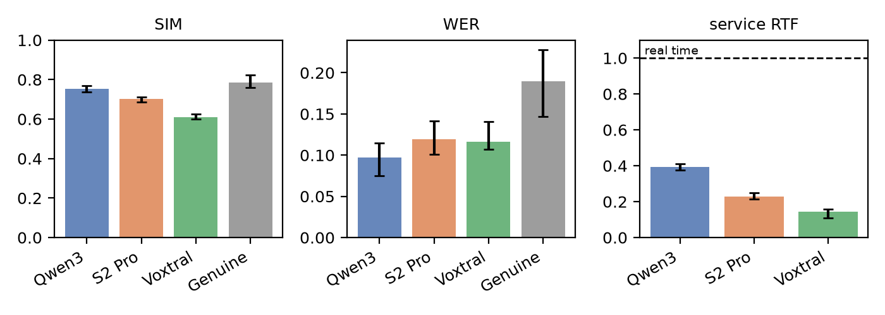
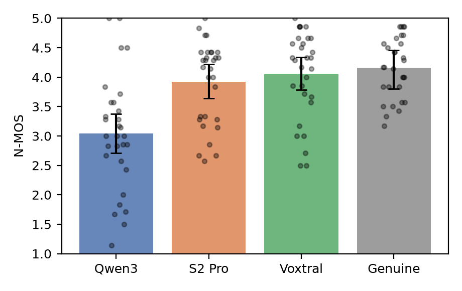
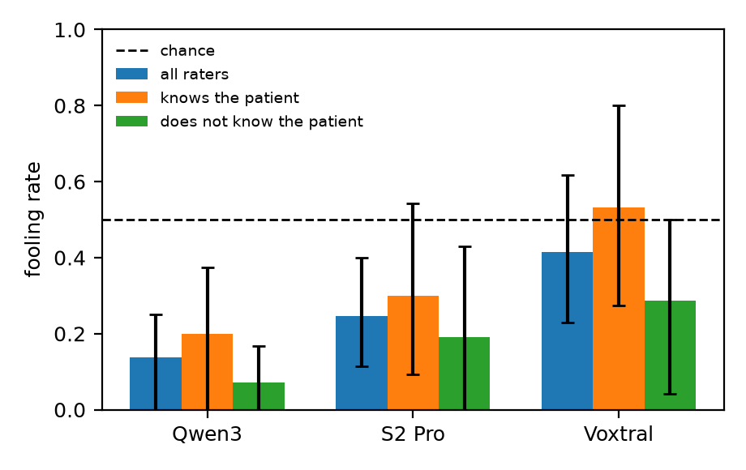
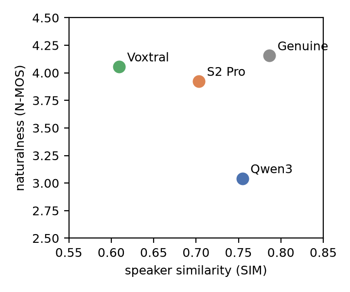

# myEcho — Voice Cloning Evaluation

Lars Seifert, M.Sc. Informatik, Hochschule Karlsruhe. Betreuer: Prof. Patrick Baier.

Part of **myEcho**, a project on voice cloning for an ALS patient. The patient
has since lost her speech. All that is left of her voice are 42 WhatsApp voice
messages from 2021, about half an hour in total, recorded on a phone for other
purposes.

**Question:** how much of a voice can be rebuilt from material that was never
recorded for this? This repository compares three commercial zero-shot
voice-cloning services on that material and holds the code, data summaries and
report sections.

## Main findings

*Short version of the thesis "Evaluation of open-source voice cloning models
for ALS patient: A case study using legacy audio data"
([PDF](docs/documentation.pdf)).*

- **Two of three systems sound as natural as the real recordings.** s2pro and
  voxtral are not separable from the genuine voice on naturalness. qwen3 is
  clearly worse.
- **No system passes as the patient in a direct comparison.** Only voxtral
  comes close to chance level in the real-vs-clone test.
- **The objective metric points at the wrong system.** qwen3 has the highest
  speaker similarity but is rated least natural and detected most often. Only
  the listening test showed this.
- **Recommendation: s2pro.** It is the only system that meets every
  requirement at once (see [below](#recommendation)). It is not chosen because
  it sounds better than voxtral; the data cannot show that.
- **The patient identified her own voice in 6 of 6 pairs** (separate session,
  kept out of all averages).
- **Legacy material is enough for an assistive voice, not for a replica.**

## Setup in short

| | |
|---|---|
| systems | **s2pro** (Fish Audio), **voxtral** (Mistral), **qwen3** (Alibaba DashScope) |
| enrollment | one 30 s reference, denoised with DeepFilterNet, same for all three |
| test material | 16 German texts; the speaker's own recordings run as a fourth condition, **REAL** |
| listening test | 30 raters, 13 texts, 52 naturalness items, 39 real-vs-clone pairs |

| measure | metric | how |
|---|---|---|
| speaker similarity | SIM | cosine similarity of ECAPA-TDNN embeddings |
| intelligibility | WER | Whisper ASR vs. the target text |
| naturalness | N-MOS, 1–5 | listening test |
| detectability | 2AFC / "raters fooled" | real vs. clone: "which is the real voice?" |
| speed | RTF, TTFA | service real-time factor, time to first audio |

Every number is read against REAL.

### Pipeline



The three services and REAL render or supply the same 16 texts. Objective
metrics and the listening test run in parallel; every service is compared
against REAL with bootstrap intervals.

### Data and preprocessing

42 voice messages (WhatsApp, 2021–2022, 30.9 min, 14–153 s each) from a 56-year-old
native German speaker, used with her written consent. Many have background
noise, visible as a constant low-frequency band (left). DeepFilterNet2 removes
it without audible damage (right). The cleaned file is the reference all three
services were enrolled with.

| before | after DeepFilterNet2 |
|---|---|
|  |  |

Further steps: mono WAV, 80 Hz high-pass, compressor (−16 dB), loudness
normalization to −24 LUFS, limiter at −1 dBFS, pause removal with a threshold
derived per file.

## Results

### Objective metrics (16 texts, medians, 95 % CI)



| condition | SIM ↑ | WER ↓ | service RTF ↓ | TTFA ↓ | usable renders |
|---|---|---|---|---|---|
| **REAL** | **0.787** | **0.190** | | | |
| qwen3 | 0.755 | 0.097 | 0.39 | 1.55 s | 16 / 16 |
| s2pro | 0.703 | 0.119 | 0.23 | 1.21 s | 16 / 16 |
| voxtral | 0.609 | 0.116 | 0.14 | – | 13 / 16 |

- qwen3 has the highest similarity and is the only system not separable from
  REAL (−0.03, adjusted CI [−0.07, +0.00]).
- All clones have a lower WER than REAL. Read speech is cleaner than a
  spontaneous phone memo, so WER measures the material here, not the model.
- voxtral is non-streaming, so it has no TTFA. It failed on 3 of 16 texts.
- All services are faster than real time (RTF < 1). The median end-to-end
  latency is still 5.7–13.8 s per text because the texts are long. A dialogue
  app would need to synthesize in short segments.

### Naturalness (30 raters)



| condition | N-MOS | 95 % CI | vs. REAL (adjusted) |
|---|---|---|---|
| **REAL** | **4.16** | [3.81, 4.46] | |
| voxtral | 4.06 | [3.79, 4.34] | −0.10 [−0.57, +0.48], not separable |
| s2pro | 3.92 | [3.64, 4.22] | −0.23 [−0.72, +0.44], not separable |
| qwen3 | 3.04 | [2.71, 3.37] | −1.12 [−1.65, −0.51] |

qwen3 is below every other condition. s2pro and voxtral are not separable from
each other or from REAL. The rating noise (60 repeat pairs) is 0.55 points, so
the s2pro–voxtral gap of 0.13 is inside the noise.

### Real vs. clone (2AFC)



Share of pairs in which the clone was picked as the real voice. 0.5 is chance.

| system | all raters | knows the speaker | does not |
|---|---|---|---|
| voxtral | 0.41 [0.23, 0.62], chance | 0.53 | 0.29 |
| s2pro | 0.25 [0.12, 0.40] | 0.30 | 0.19 |
| qwen3 | 0.14 [0.00, 0.25] | 0.20 | 0.07 |

voxtral is the only system raters could not tell from the real voice above
chance. The fooling rate is a lower bound on how distinguishable the clones
are: pausing and brightness still leak through (see Limitations).

Raters who know the patient were fooled *more* often than strangers (+0.13,
+0.11, +0.25), but all three intervals contain zero: a trend, not a result.
The effect cannot be interpreted yet: no unfamiliar rater was older than 42,
the familiar group has a median age of 51, and hearing was not screened.

### Similarity and naturalness disagree



The metric and the listeners rank the systems in opposite order. The system
closest to the real voice in embedding space (qwen3) is rated least natural.
The system farthest away (voxtral) is rated closest to REAL.

### Hypotheses ([PREREGISTRATION.md](PREREGISTRATION.md))

| | hypothesis | outcome |
|---|---|---|
| H1 | all systems below REAL on naturalness | numerically yes for all three, confirmed only for qwen3 |
| H2 | naturalness follows similarity | **reversed** |
| H3 | all systems detected above chance | fails for voxtral |
| H4 | knowing the speaker increases detection | opposite direction, no difference excludes zero (n = 15 vs. 14 per system) |

## Recommendation

| requirement | qwen3 | s2pro | voxtral |
|---|---|---|---|
| natural as the real recordings | no | yes | yes |
| renders every text | yes | yes | no (13 / 16) |
| usable licence | yes | yes | non-commercial |

- **qwen3** is ruled out by perception.
- **voxtral** is ruled out by licence and reliability: a system that fails on
  one text in five cannot replace a voice.
- **s2pro** meets all requirements. Still open: all three systems ran through
  provider APIs, so the enrollment recording left the machine. Self-hosting was
  not tested.

## Lessons

1. **Zero-shot is enough.** A reference of a few seconds matched the fine-tuned
   model in a listening comparison, at a fraction of the compute.
2. **Preprocessing still matters.** DeepFilterNet removed the phone noise, but
   it also created digitally silent pauses that the listening test had to
   neutralise.
3. **Objective metrics are not enough.** They pointed at the wrong system.

## Limitations

- One speaker: intervals generalize over texts and raters, not over speakers.
- Raters are a convenience sample without hearing screening. The 15 / 15 split
  on familiarity is by chance.
- The three excluded texts are all voxtral failures, so every system is scored
  on material selected by voxtral's success.
- Real side is spontaneous speech on a phone line; clones read a transcript.
- No low anchor, so absolute N-MOS values are only comparable within this study.

All ten limitations: [docs/METHODS.md](docs/METHODS.md#9-limitations).

## Go deeper

| | |
|---|---|
| Full thesis (PDF) | [docs/documentation.pdf](docs/documentation.pdf) |
| Methodology and all numbers | [docs/METHODS.md](docs/METHODS.md) |
| Preregistered hypotheses | [PREREGISTRATION.md](PREREGISTRATION.md) |
| Report sections (LaTeX) | `docs/paper/` |
| Run it yourself, repository layout | [docs/REPRODUCING.md](docs/REPRODUCING.md) |

Quickstart (needs [uv](https://docs.astral.sh/uv/), Python 3.11+, your own
recordings in `data/` and API keys in `.env`):

```bash
uv sync --extra eval && cp .env.example .env
make objective   # calls the APIs
make results     # analysis from the listening-test data
```

All audio and rater-level data stay out of the repository.
