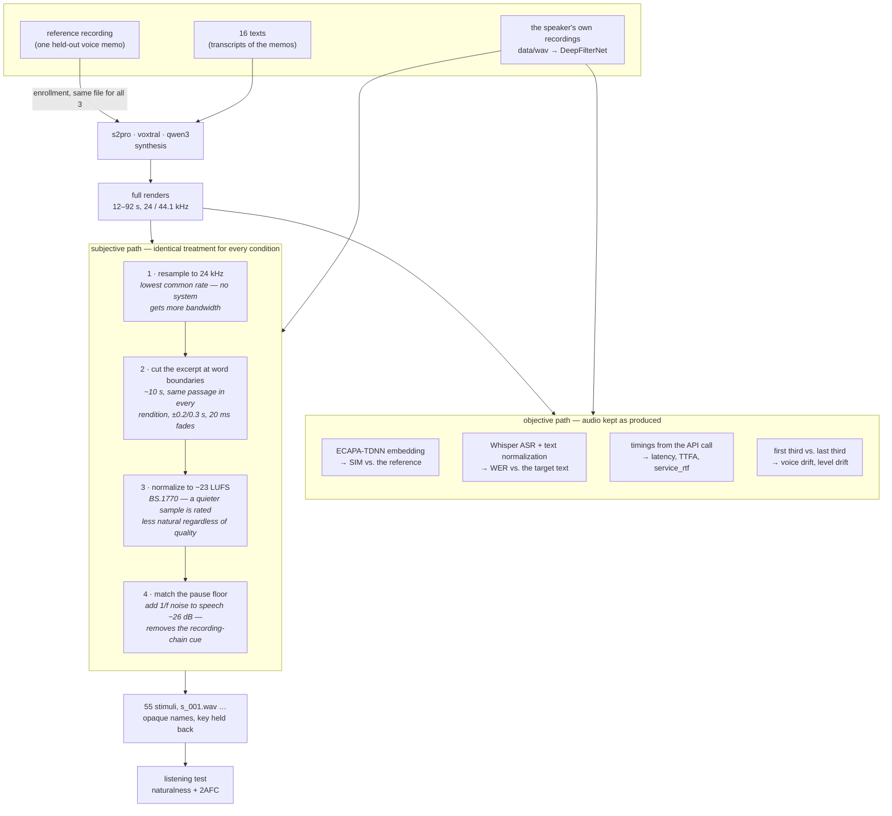

# Evaluation methodology

Why the evaluation is built the way it is, with the measured numbers behind each
decision. The README says how to run it; this says why. Structured to map onto
the *Evaluation/Experimente* chapter of the report.

Contents: [1 Setup](#1-setup) · [2 Objective metrics](#2-objective-metrics) ·
[3 Stimulus length](#3-stimulus-length) ·
[4 Audio processing](#4-audio-processing) · [5 Confounds](#5-confounds) ·
[6 Listening-test design](#6-listening-test-design) ·
[7 Statistics](#7-statistics) · [8 Limitations](#8-limitations)

---

## 1 Setup

One German speaker (an ALS patient), 16 texts that are transcripts of their own
2021 voice memos, three commercial cloning services: **s2pro** (Fish Audio),
**voxtral** (Mistral), **qwen3** (Alibaba DashScope). Each service renders each
text; the speaker's own recording of the same text is kept as a fourth
condition, **REAL**.

Four conditions rather than three is the central design choice. Every metric
below is a number without a scale until there is something to compare it to, and
the only honest reference is the person themselves.

---

## 2 Objective metrics

### SIM — speaker similarity

Cosine similarity between ECAPA-TDNN embeddings (`speechbrain/spkrec-ecapa-voxceleb`)
of the reference recording and the rendered audio.

An ECAPA cosine has no absolute meaning — it depends on the speaker, the
recording and the checkpoint. So it is bracketed:

- **upper bound**: the speaker against *themselves*, i.e. the reference recording
  vs. their other real recordings
- **lower bound**: the reference vs. a *different* speaker (`impostor_audio`)

| condition | SIM (median) | 95 % CI |
|---|---|---|
| **REAL (upper bound)** | **0.79** | range 0.67–0.86 |
| qwen3 | 0.743 | [0.729, 0.758] |
| s2pro | 0.707 | [0.693, 0.721] |
| voxtral | 0.600 | [0.572, 0.630] |
| IMPOSTOR (lower bound) | not yet measured | — |

**qwen3 and s2pro fall inside the range the metric returns for two recordings of
the same person.** ECAPA cannot separate their clones from the real speaker, so
the difference between them is resolvable by the metric but is *not* evidence
that one clone is closer to the person. voxtral is clearly below. Without the
upper bound, "SIM = 0.70" is uninterpretable and this conclusion is unavailable.

The lower bound is the one number that cannot be produced from this project's own
data. A stand-in test using another recording of the *same* speaker scored 0.733
— inside the clone range — which is exactly why a genuinely different voice is
needed before absolute SIM values are quoted.

Caveat: ECAPA-VoxCeleb is trained on 16 kHz English celebrity speech. It is out
of domain for German phone voice memos, and that is a limit on all SIM values
here, not just on the differences.

### WER — word error rate

Whisper ASR transcribes the rendered audio; `jiwer` compares it to the target
text. Both sides are normalized identically (case, punctuation, umlaut
transliteration, hyphens, digits → German number words), so the metric does not
measure the ASR's formatting habits.

| condition | WER (median) | 95 % CI |
|---|---|---|
| **REAL (floor)** | **0.18** | — |
| qwen3 | 0.079 | [0.058, 0.104] |
| s2pro | 0.100 | [0.087, 0.125] |
| voxtral | 0.112 | [0.098, 0.171] |

**The clones score better than the human original.** Reading a transcript
produces cleaner, more canonical speech than speaking spontaneously into a
phone. So WER here does not measure intelligibility — it measures *distance from
read speech*, and a value below the human floor is not a quality win.

Second consequence: the measurement floor (0.18) is larger than the differences
between systems (0.02–0.11). Paired by text, the **qwen3 vs. s2pro WER
difference is not detectable** (−0.019, adjusted CI [−0.051, +0.014]). A
German-finetuned ASR would tighten this; if it is swapped in, every WER value
including the floor must be recomputed in one pass.

### Service latency

`service_rtf` = wall-clock API latency ÷ length of the returned audio. Named
`service_rtf` and not `RTF` on purpose: real RTF is compute time ÷ audio
duration on known hardware, and none of these APIs expose that. What is measured
is three different services over the internet — one non-streaming, one hosted in
Singapore. `connect_s` reports the handshake separately as an RTT proxy. All
timings start before the connection is opened, so they are comparable.

---

## 3 Stimulus length

### How it is computed

The duration is not set directly. A target duration becomes a word count, a
passage of that length is chosen **on the text**, and the resulting audio length
is whatever that passage takes in each voice.

```
words_per_second = 2.94             # measured median across the three systems
target = round(10.0 × 2.94) = 29 words
band   = [round(8.0 × 2.94), round(13.0 × 2.94)] = [24, 38] words
```

1. Skip the first `SKIP_HEAD_FRAC = 15 %` of the words — the opening of a voice
   memo is a greeting, and the first seconds of a render carry onset artifacts
   that differ per system.
2. Take the run of **consecutive whole sentences** whose word count falls in the
   band and lies closest to `target`. If a single sentence exceeds the band
   (these are spontaneous-speech transcripts; one text has a 49-word
   "sentence"), split it at commas instead. Only if neither works, use a plain
   word window and flag the ragged end.
3. Locate that passage in every rendition via Whisper word-level timestamps and
   a fuzzy token match (`difflib`, longest common subsequence). Below a 0.6 token
   match the system did not say the passage — reported and excluded, never
   replaced by a time window.
4. Cut `start − 0.2 s` to `end + 0.3 s`, with 20 ms fades (a hard cut clicks, and
   a click is heard and rated as an artifact).

Steps 1–2 touch no audio, so the choice cannot favour any system. Result on 16
texts: 14 end at a sentence boundary, 2 at a comma, none mid-sentence. Final
durations **5.8–14.8 s, median 9.6 s**; 55 stimuli, 9.0 min of audio.

### Why ~10 s and not the full render

Five reasons, each with a number.

1. **The unit of judgement must match the unit of analysis.** ACR asks for one
   score per stimulus. A 36 s render contains several distinguishable quality
   events, and the rater compresses them with an unknown weighting — so the
   score is an unrecorded mixture, not "the naturalness of this system". ITU-T
   P.800 Annex B uses stimuli of roughly this length for the same reason.
2. **Session length.** Full renders meant ~46 min of pure audio per rater, i.e.
   60–75 min sessions; the second half of such a session measures fatigue. Now
   6.1–6.5 min of audio, ~20 min per session.
3. **Power per unit of rater time.** For a fixed budget `T`, items `n ≈ T/duration`
   and the standard error of a mean falls with `1/√n`. Going from a 36 s median
   to 9.6 s is **3.75× the items** for the same rater time, i.e. intervals about
   **1.9× narrower** — without recruiting anyone.
4. **More items means more text clusters** for the interval to resample over
   (see §6), which is what makes keeping all 13 texts × 4 conditions affordable.
5. **Content matching becomes possible.** Every system is judged on the same
   passage; with full renders a rater also compares which parts of a 90-second
   voicemail they happened to attend to.

### Why not "the first 10 seconds"

The systems speak the same text at different rates — 1.16× spread at the median,
up to **1.53×**. A fixed window therefore holds a different *amount of content*
per system and lands mid-word more often for the slower one. On this material
that would have penalized voxtral, which is already the weakest — a bias
pointing in the direction of the conclusion.

### What it costs, and the answer

The excerpts sit at **32–71 %** of each render: about **73 % of what each system
produced is never heard by a rater**. Measured on the full renders instead
(`analyze_objective.py --long-form`):

| source | dur. ratio | words/s | level drift | sim 1st → 3rd | drift |
|---|---|---|---|---|---|
| REAL | 1.000 | 2.53 | +0.8 dB | 0.758 → 0.773 | +0.030 |
| qwen3 | 0.901 | 2.92 | −1.2 dB | 0.715 → 0.717 | +0.004 |
| s2pro | 0.845 | 3.00 | −1.7 dB | 0.670 → 0.672 | +0.011 |
| voxtral | 0.966 | 2.71 | −2.8 dB | 0.586 → 0.598 | +0.008 |

- **No system drifts away from the target voice over a long utterance**
  (correlation of render length with drift: r = −0.05, n = 48). The largest
  single drift in the whole set belongs to a *real* recording. So excerpting
  hides no speaker-identity problem — a measured statement, not an assumption.
- **voxtral fades out**, up to −11.4 dB across one render. A genuine long-form
  defect that loudness-normalized 10 s excerpts cannot show.
- **All three speak faster than the person** (2.7–3.0 vs 2.53 words/s).

---

## 4 Audio processing

Two separate paths. The **objective** path measures the renders as the services
returned them — nothing is normalized, because SIM and WER should see what the
service actually produced. The **subjective** path prepares stimuli for human
ears, and there every condition has to be put through exactly the same treatment,
or a rater ends up judging the recording chain instead of the voice.



**Why that order.** The cut runs *before* normalization: BS.1770 integrated
loudness is measured over the whole signal, so normalizing a 42 s render and then
cutting 10 s out of it would leave the excerpts at different levels again — the
exact confound step 3 exists to remove. The pause floor is matched *after*
normalization, so the added noise sits at a fixed distance below a speech level
that is already the same everywhere.

**One file through all four steps** (s2pro, `AUDIO-2021-08-30-06-40-21`):

| stage | length | rate | loudness | peak | speech − pause |
|---|---|---|---|---|---|
| source render | 42.66 s | 44 100 Hz | −21.57 LUFS | −4.90 dBFS | 37.1 dB |
| 1 resample | 42.66 s | 24 000 Hz | −21.57 LUFS | −4.92 dBFS | 37.1 dB |
| 2 cut (30.72–40.36 s, match 0.87) | 10.14 s | 24 000 Hz | −21.52 LUFS | −4.92 dBFS | 29.0 dB |
| 3 normalize (−1.5 dB) | 10.14 s | 24 000 Hz | **−23.00 LUFS** | −6.40 dBFS | 28.6 dB |
| 4 pause floor (noise at −57 dBFS) | 10.14 s | 24 000 Hz | −23.00 LUFS | −6.37 dBFS | **25.8 dB** |

After step 4 every stimulus in the test sits at the same loudness and the same
distance from its own noise floor, whatever it came from. What survives is the
voice, the prosody and the pause *structure* — which is what raters are there to
judge.

**What is deliberately not done:** no denoising of the renders, no equalization,
no de-clicking, no trimming of leading or trailing silence beyond the excerpt
cut. Each of those would hide a defect that belongs in the rating. The real
recordings are denoised (DeepFilterNet), but that happens before this pipeline
and is the reason step 4 exists at all — see §5.

---

## 5 Confounds

Every stimulus goes through identical processing: resample to 24 kHz → cut →
loudness-normalize to −23 LUFS (BS.1770) → match the pause floor to speech
−26 dB.

### Level

qwen3 renders ~7 dB quieter than the other two, and a quieter sample is rated
less natural almost regardless of its quality. Loudness (not RMS) because
BS.1770 gating ignores silence, so a gappy render is measured on its speech.

### Recording chain — the important one

The real recordings are phone voice memos put through DeepFilterNet; the clones
are generated clean. Before matching:

| | pause fraction | speech − pause floor |
|---|---|---|
| REAL | 0.22 | 39.4 dB |
| s2pro | 0.08 | 33.0 dB |
| voxtral | 0.15 | 28.7 dB |
| qwen3 | 0.10 | 29.6 dB |

A single threshold on either column identifies the real recording with **96 %
accuracy**. The cue is self-inflicted: denoising moves the real recordings from
0.132 / 30.6 dB to 0.219 / 36.8 dB, i.e. it gives them *digitally silent* pauses
that no TTS model produces. A rater noticing "the one with dead-silent gaps is
real" wins without judging a voice.

Fix: raise every stimulus's pause floor to one common value by adding 1/f-shaped
noise — only ever adding, because lowering a floor would mean denoising one
condition and not the others. Deterministic (seed from the filename). The cue
drops to **0.745 against a 0.750 guessing baseline**. Pause *structure* is left
untouched, since how often a voice stops is a property of the system.

### Residual cue, reported not removed

After matching, one feature still separates real from clone above baseline:
energy in 4–8 kHz, **0.885 vs 0.750**. All three systems render duller than the
phone-recorded original. This is partly the recording chain and partly a real
failure to reproduce the source timbre; equalizing it would also erase what
raters are there to hear. It is measured (`cue_audit.csv`) and must be reported
next to the 2AFC results.

### Enrollment — not yet removed

qwen3 was enrolled with `enable_preprocess=True` (server-side denoising), voxtral
with raw bytes plus a hardcoded `gender="female"`, s2pro through a web UI. **The
three did not receive the same input**, so a SIM difference can come from the
model or from one model having been handed cleaner audio. This is the largest
single threat to the conclusion. Code defaults are now neutral and
`prepare_enrollment.py` produces one canonical reference with a hash manifest,
but the numbers in §2 predate that. Either re-enroll and re-run, or state in the
report that the ranking is confounded with the enrollment input.

---

## 6 Listening-test design

### Two tasks

- **Naturalness (ACR 1–5)**, five verbal labels per ITU-T P.800, all four
  conditions including REAL.
- **2AFC detectability**: one real recording vs. one clone of the same passage,
  "which is the real voice". Fooling rate 0.50 = indistinguishable from guessing.

### Rater plans

6 plans = 2 role groups × 3 model rotations; each rater draws one at random.
A plan sends half the texts to the naturalness part and half to the 2AFC part.

Two problems this solves at once:

1. **No rater meets the same text in both parts.** With content-matched excerpts
   and REAL as a rated condition, part 1 would otherwise contain the answer to
   part 2.
2. **All text × model pairs get used.** The earlier design assigned one model per
   text, giving the 2AFC test 5 distinct pairs per model — and more raters could
   not fix that, because the interval was over 5 items however many people
   answered. Now 39 pairs, 13 per model, fully balanced.

Plans are enumerated rather than drawn per rater, so cell coverage does not
depend on luck at n ≈ 30.

### Per rater

Order shuffled; A/B sides flipped and logged; three unscored training items
first; part 2 locked until part 1 is complete; two hidden repeats at least 6
positions from their original (naively shuffled, 7 % landed back-to-back, where
the two ratings agree from memory and the reliability estimate comes out too
good). Generated anonymous id, no names. The **rater** enters the scores, not the
operator — the operator is the author of the system.

Counts: 13 usable texts × 4 conditions = 52 naturalness items, 39 pairs, 24–28
items and 6–7 pairs per rater.

### Blinding

All stimuli are named `s_001.wav`, assigned after the shuffle; `key.json` holds
the only mapping and is not shipped. An earlier version wrote
`turing_03_real.wav` into the page manifest, where any rater could read it.
`check_listening_test.py` gates 17 such properties and exits non-zero.

### Exclusions, fixed in advance

Technical failures only, never "this sounds bad" — that is what raters judge.

- cannot reach target loudness without clipping; essentially no speech; clipped
- excerpt not found in the rendition (< 0.6 token match): the system did not say it
- excerpt found but stretched over > 2× the per-text median span: a runaway render

`duration_off` / `silence_heavy` alone are **not** exclusions — they usually mean
the system speaks slower or pauses more, which raters should hear.

If a text is excluded for one system it is dropped for all, so every condition is
scored on identical material. On this set: three voxtral renditions, hence 3 of
16 texts, leaving 13. Two of the three were independently flagged by both the
level screening and the alignment — two methods agreeing on which renders are
broken.

---

## 7 Statistics

**Naturalness**: mean of per-rater means (so every person carries equal weight
despite different plan sizes). **2AFC**: fooling rate, same aggregation.

**Intervals** come from a two-way cluster bootstrap: each replicate resamples
raters *and* texts with replacement. Answers are not independent — each rater
answers many items and each item is answered by many raters — so pooling them as
independent observations gives intervals that are too narrow.

**Coverage was checked by simulation** on this exact design, before any data
existed (`tools/check_ci_coverage.py`):

| method | coverage of the nominal 95 % CI |
|---|---|
| two-way (used) | **0.99** |
| raters only | 0.93 |

The interval is **conservative** — too wide, not too narrow. That is kept and
reported rather than tuned away: a wide interval can only weaken a claim, a
narrow one manufactures findings. The cost is sensitivity, so a null result
should be quoted with this figure.

**Power**, same simulation: a 0.30 MOS difference is detected with 80 % power at
30 raters (0.20 → 35 %, 0.40 → 98 %). So 30 raters is roughly the right number,
and a smaller difference will be reported as *not detectable*, not as absent.

**Pairwise comparisons** are paired within rater, which removes each rater's
scale offset — the largest noise source in a MOS study — and their verdict uses a
Bonferroni-adjusted level: 4 conditions means 6 comparisons, and at a nominal 5 %
each the family-wise error rate would be ~26 %.

**Familiarity** is reported as the contrast with its own interval, not as two
subgroup intervals to compare by eye: two overlapping intervals can hide a real
difference and two separated ones can appear without one.

**Rating noise** comes from the hidden repeats: the mean absolute difference
between two ratings of the same stimulus by the same rater. A condition
difference smaller than that is inside one person's own scale noise — real,
perhaps, but not meaningful.

If `statsmodels` is installed, a mixed model (`rating ~ condition`, random rater
and text) and a rater-clustered logit are fitted as a confirmatory check. The
bootstrap stays the headline at this sample size.

---

## 8 Limitations

1. **One speaker.** This is a case study. Intervals generalize over texts and
   raters, not over speakers. Nothing here says how these systems behave on a
   different voice.
2. **Enrollment confound** (§5) — the largest one, and still present in the
   numbers.
3. **SIM lower bound missing**, so absolute similarity values are uncalibrated.
4. **WER floor larger than the effects** (§2), measured with whisper-small.
5. **73 % of each render is not rated subjectively** (§3), answered objectively
   rather than assumed away.
6. **Residual brightness cue**, 0.885 vs 0.750 (§5).
7. **Spontaneous vs. read speech.** The real side is spontaneous with
   hesitations; the clones read a transcript of it. Disfluencies are in the text,
   but the delivery differs — and that is part of what makes a clone detectable.
8. **The operator is the author.** Rater clicks, key unopened, sides re-flipped
   per rater — but this is not a blind experimenter.
9. **Convenience rater sample**, no hearing screening, and the familiarity
   subgroup will be small unless recruited to a quota.
